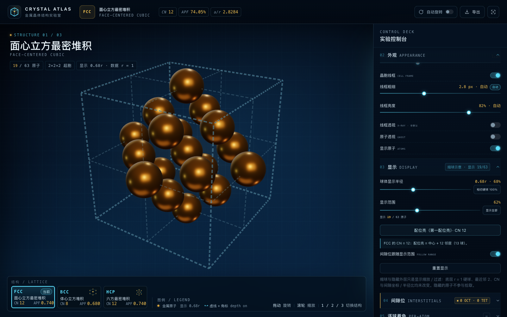
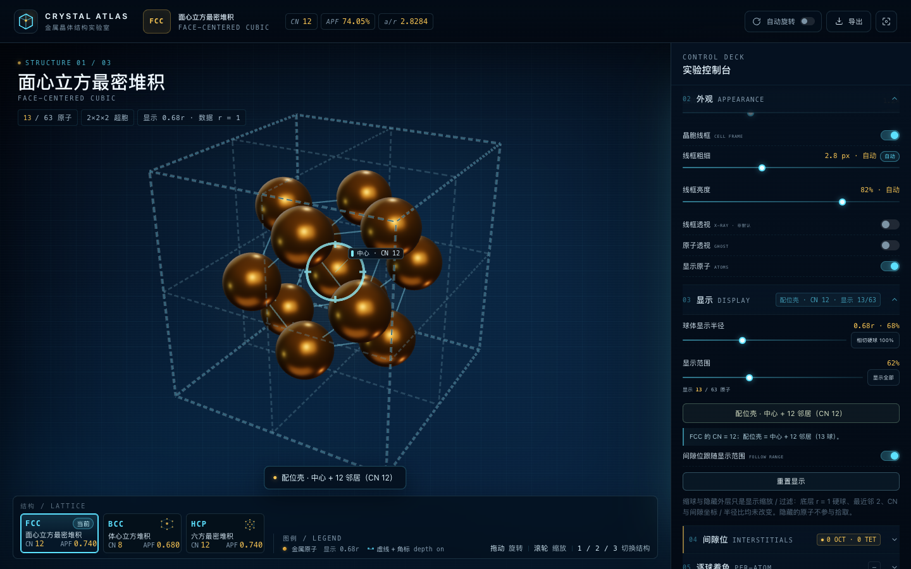
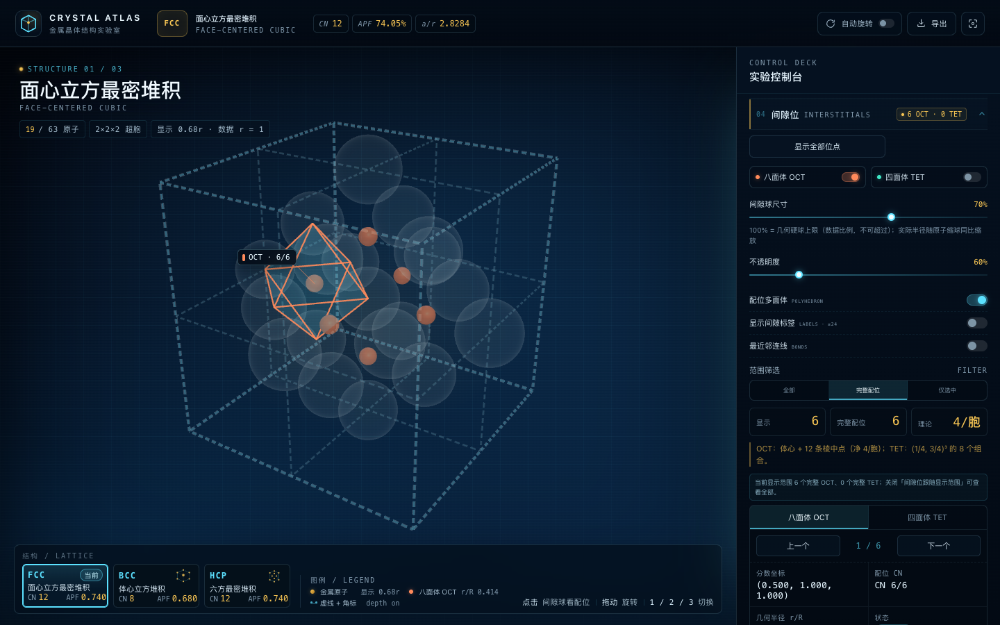
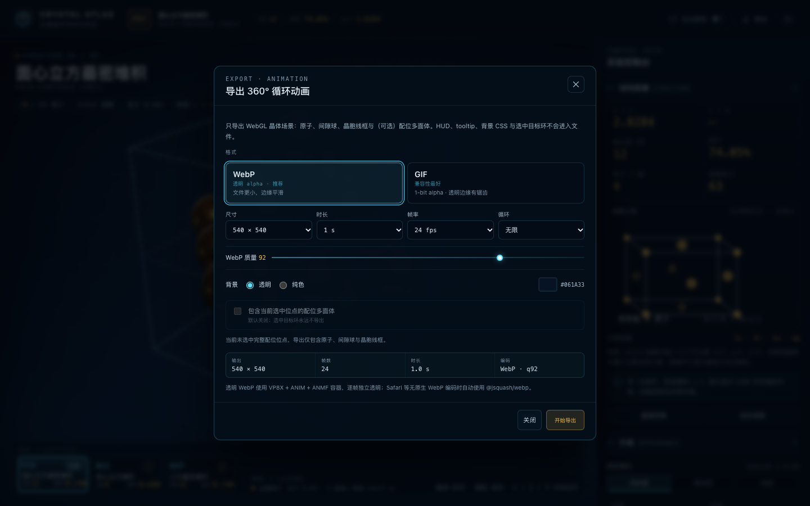
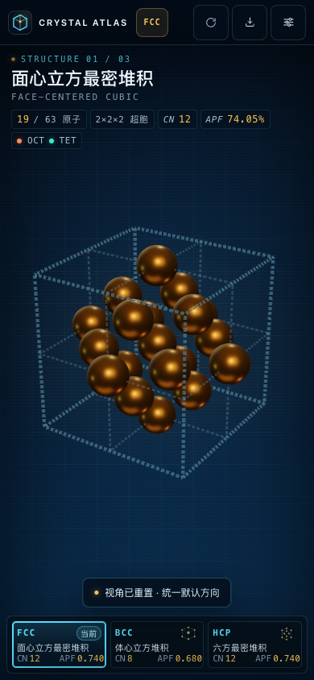

# Metal Crystal 3D · CRYSTAL ATLAS

一个在浏览器里运行的金属晶体结构交互可视化工具：FCC / BCC / HCP 等径硬球团簇、晶胞线框、配位壳层与四面体 / 八面体间隙位，支持逐球改色与透明动画导出。



## 功能

- **三种结构**：面心立方（FCC）、体心立方（BCC）、六方密排（HCP），一键切换并共用同一相机比例尺。
- **等径硬球**：所有原子半径严格归一化为 r = 1，最近邻中心距为 2，球体相切。
- **配位壳**：显示第一配位壳的中心原子与全部邻居，并绘制对应的配位多面体（cuboctahedron / cube / anticuboctahedron）。
- **缩球显示**：默认以 0.68r 显示以看清内部结构，滑杆 50–100% 实时调整，100% 恢复相切；也可按径向范围过滤原子。
- **逐球改色**：开启编辑后点击任意原子单独上色，用于标注缺陷、掺杂或特定晶位。
- **间隙位**：八面体（O）与四面体（T）间隙位、r/R 比值、配位多面体与边界欠配位提示。
- **透明动画导出**：360° 循环旋转，默认 1080×1080 / 3 s / 30 fps 的透明 WebP，也可导出 GIF 或纯色背景。
- **科技蓝界面**：深空蓝背景、发光晶胞线框、桌面与移动端自适应面板。

| 配位壳 | 间隙位 |
| --- | --- |
|  |  |

| 导出面板 | 移动端 |
| --- | --- |
|  |  |

## 科学说明

模型为理想等径硬球，长度以最近邻距离的一半归一化，即 **r = 1**，最近邻中心距 = 2。界面上的缩球只改变显示半径，不改变任何晶体学数据。

| | FCC | BCC | HCP |
| --- | --- | --- | --- |
| 晶格常数 a（以 r 计） | 2√2 | 4/√3 | 2 |
| c/a | — | — | √(8/3) ≈ 1.633 |
| 配位数 CN | 12 | 8 | 12 |
| 致密度 APF | 0.74048 | 0.68017 | 0.74048 |
| 原子 / 胞 | 4 | 2 | 2（原胞）/ 6（六方棱柱） |
| O / T 间隙位每胞 | 4 / 8 | 6 / 12 | 2 / 4（原胞）、6 / 12（棱柱） |
| r_O / R | 0.41421 | 0.15470 | 0.41421 |
| r_T / R | 0.22474 | 0.29099 | 0.22474 |

- **FCC / HCP 的 CN = 12，BCC 的 CN = 8。** BCC 的 8 个最近邻构成一个立方体，界面不会为了凑 12 而添加原子。
- **BCC 八面体间隙是扁八面体**：2 个近邻位于 a/2，4 个远邻位于 a/√2，几何半径由近邻锁定，因此 r_O/R 明显小于 FCC/HCP。
- **HCP 计数**：原胞含 2 个原子、2 个八面体间隙位与 4 个四面体间隙位；常规六方棱柱含 6 个原子、6 个八面体间隙位与 12 个四面体间隙位。3D 棱柱锚定在配位壳中心原子上，是平移后的等价单胞。
- **缩球只是显示**：默认 0.68r 仅用于观察内部，底层 `Atom.radius` 始终为 1；把显示半径调到 100% 即恢复硬球相切，CN、间隙坐标与 r/R 均不受影响。
- 有限团簇的边界位点配位不完整，界面以 `!` 标注为边界欠配位，不绘制配位多面体。

## 快速开始

需要 Node.js 20.19+ 或 22.12+。

```bash
cd metal-crystal-3d
npm install
npm run dev
```

打开终端提示的本地地址即可。生产构建：

```bash
npm run build
npm run preview
```

## 使用说明

**结构切换**：顶栏或键盘 `1` / `2` / `3` 切换 FCC / BCC / HCP；`Space` 开关自动旋转，`R` 重置视角，`Esc` 取消选择或关闭弹窗。

**旋转与缩放**：拖动旋转，滚轮缩放。拖动时自动旋转暂停，松手后恢复。

**显示面板**：
- `显示半径` 调整缩球比例，`显示范围` 按径向距离过滤原子，实时显示“显示 X / N 原子”。
- `配位壳` 只保留中心原子与第一配位壳，并绘制配位多面体。
- `显示全部`、`相切硬球 100%`、`适应视图` 会自动重新取景；拖动滑杆不会改变相机。
- `重置显示` 恢复默认的 0.68r / 62% / 跟随间隙位。

**间隙位面板**：分别开关八面体与四面体间隙位，列表点击可平滑聚焦到具体位点；开启任一间隙位会自动进入原子透视模式，便于观察内部空腔。`完整配位` 按当前可见原子重新统计。

**逐球改色**：打开编辑模式后点击原子选择颜色，点击空白处取消选择；拖动超过 4 px 不会误触发选择。

**导出**：顶栏“导出”打开动画弹窗，见下一节。

## 导出

- 默认输出 **1080×1080、3 s、30 fps、透明背景的动画 WebP**，质量 92，无限循环。
- 可选 540 / 720 / 1080 / 1440 方图，1–5 s，24 / 30 fps，透明或纯色背景（默认 `#061A33`），以及是否包含当前间隙位的配位多面体。
- 画面只包含 WebGL 场景（原子、间隙球、晶胞线框、可选配位多面体）；HUD、CSS 背景、标签与选中环不会进入文件。
- 导出期间显示逐帧进度，可随时取消；完成后先预览再手动下载，文件名形如 `crystal-atlas-fcc-1080px-3s-30fps.webp`。
- **GIF** 只有 1-bit alpha，透明边缘会出现硬边或锯齿；需要平滑半透明请使用 WebP，或改用纯色背景。
- **Safari / 浏览器限制**：当浏览器不支持 canvas WebP 编码时，会自动切换到内置的 WASM 编码器（`@jsquash/webp`），输出仍是标准动画 WebP；两条路径都失败时会明确报错并建议改用 GIF。
- 部分旧版播放器或聊天软件只显示动画 WebP 的第一帧，这属于播放器兼容性问题，文件本身可被浏览器与 ffmpeg 正常解码。

> 透明动画使用浏览器的 canvas 编码能力，导出 1080 / 90 帧在无 GPU 的无头环境中会明显变慢；桌面浏览器正常使用 GPU 时不受影响。

## 开发与测试

```bash
npm test            # Vitest：晶体学核心、可见性、HCP 棱柱、WebP muxer
npm run typecheck   # tsc --noEmit
npm run build       # 类型检查 + Vite 生产构建
```

以下两个端到端脚本需要额外环境：

```bash
npm run visual      # Playwright 无头视觉与交互验收
npm run test:export # 导出文件解码、alpha、取消恢复与 fallback 验收
```

- 两者都使用 `playwright-core`，需要本机已安装对应的 Chromium（`npx playwright install chromium`）。如浏览器在非标准位置，可用 `CHROMIUM_PATH` 指定可执行文件。
- `npm run test:export` 还需要 `ffmpeg` / `ffprobe` 用于解码校验。
- 截图与验收报告写入 `artifacts/`（已在 `.gitignore` 中忽略）。`npm run visual` 会占用 4173 端口，`npm run test:export` 使用 4174。

## 目录结构

```
src/crystal/     晶体学核心：结构生成、最近邻、可见性（纯函数，不依赖 DOM / Three.js）
src/scene/       Three.js 场景：原子实例、晶胞线框、间隙位、配位壳、标签
src/ui/          控制面板、模板、HUD、导出弹窗
src/export/      WebP muxer、GIF 编码、逐帧导出会话
src/state.ts     UI 与场景的单一状态源
scripts/         无头视觉与导出验收脚本
tests/           Vitest 单元测试
```

## 已知限制

1. 有限团簇的边界位点配位不完整，这是教学团簇的边界效应，不是晶体缺陷模型。
2. HCP 的六方棱柱是常规六方胞（3 个原胞 / 6 原子），不是整个 19 原子团簇的外框。
3. 模型不包含热振动、缺陷、表面重构与电子结构。

## License

[AGPL-3.0-only](LICENSE) © yblpoi
